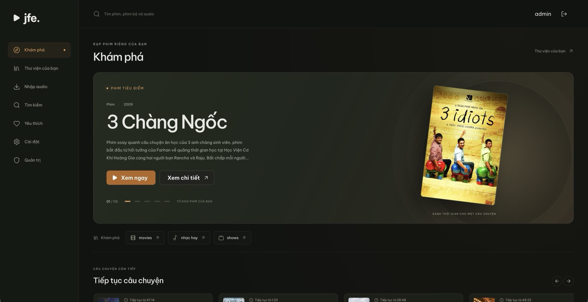
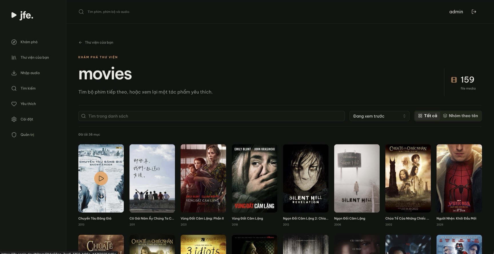
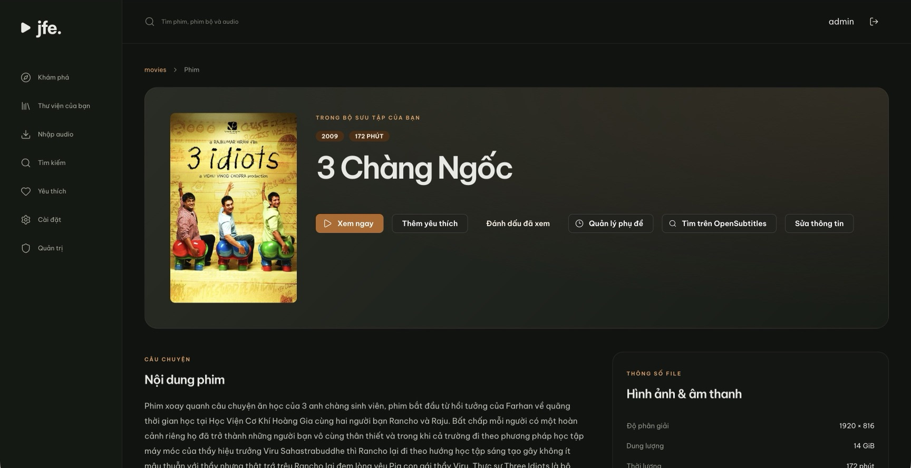
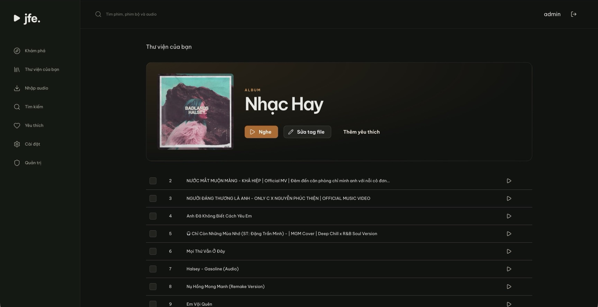

# JFE

**Your personal cinema. Your music. Your server.**

JFE is an independent, self-hosted media server for movies, TV series, music,
podcasts and audiobooks. Turn your local collection into a cinematic library,
watch in your browser, and keep listening as you explore—all from one place.

[Website](https://jfe.sonlc.dev/) · [Getting started](docs/operations.md) ·
[Architecture](docs/architecture.md) · [Project roadmap](PLAN.md)



## Made for your collection

- **A cinematic library.** Browse poster grids, featured titles and dedicated
  movie and series pages. Search your collection, explore cast filmographies,
  save favorites and pick up where you left off.
- **Video playback that fits your setup.** Direct play and remux preserve the
  original video when compatible. Optional NVIDIA NVENC HLS adds quality presets,
  subtitle burn-in and supported HDR-to-SDR conversion.
- **Music and long-form audio.** Organize albums, artists, podcasts and audiobooks.
  Use queues, shuffle and repeat for music, or resume, playback speed and a sleep
  timer for longer listening. A persistent mini-player keeps audio with you as
  you browse.
- **Metadata you control.** Scan local files, NFO metadata and artwork, enrich
  movies and series with optional TMDB metadata, and edit audio tags individually
  or in bulk. MusicBrainz can help fill an editable metadata draft.
- **Subtitles for the way you watch.** Choose tracks, upload personal subtitles
  and save personal timing adjustments. Optional OpenSubtitles integration can
  find subtitles manually or add missing Vietnamese sidecars automatically for
  selected libraries.
- **Public YouTube audio imports.** Preview a video or playlist, import its audio,
  or follow it for new additions. Subscriptions append new items while preserving
  existing files and edited tags.
- **Your server, your access rules.** Manage independent user accounts, library
  access and import permissions. Schedule scans and inspect worker status, task
  history and job logs from the administration pages.
- **English and Vietnamese.** Switch between both interface languages in a
  responsive web app built for browsing, watching and listening.

Video transcoding is disabled by default. Video encoding and subtitle playback
require a configured NVIDIA NVENC worker; JFE has no CPU video encoding fallback.
Audio conversion remains available with video transcoding disabled. External
metadata, subtitle and import services are optional and require their respective
configuration and provider access.

## Screenshots

Captured from [jfe.sonlc.dev](https://jfe.sonlc.dev/) with the Vietnamese interface.
The titles and artwork shown belong to the example server's collection.

### Browse your movie library

A poster grid brings your collection together with search, sorting and grouped views.



### Get closer to each title

Open a movie to read its story, explore its cast, inspect available files and
manage metadata or subtitles.



### Keep your audio in the same place

Browse an album's tracks, start listening and manage file tags without leaving JFE.



## Run JFE

JFE runs on your own server with PostgreSQL, a web frontend and four backend
processes: `api`, `scanner`, `transcoder` and `downloader`.

1. Configure the server using [backend/.env.example](backend/.env.example), with
   a PostgreSQL connection and shared media/cache paths.
2. Apply database migrations with the external `migrate` CLI, then start the API,
   frontend and workers.
3. Open the web app, create the initial administrator, add libraries and scan
   your collection.
4. Enable optional providers, audio imports or NVIDIA playback features as needed.

See [deployment and local development](docs/operations.md) for prerequisites,
commands, reverse proxy routing, volume permissions and NVIDIA configuration.

Docker images can be built from the repository root:

```sh
docker compose -f build/compose.yaml build
```

This Compose file builds images only. Your deployment supplies PostgreSQL,
migrations, worker services, networking and shared volumes.

## Built with

| Layer | Technologies |
| --- | --- |
| Web app | React, TypeScript, Mantine, TanStack Query, Zustand, i18next |
| Server | Go, Fiber v3, PostgreSQL, pgx, sqlc, zerolog |
| Media | FFmpeg/ffprobe, NVIDIA NVENC, MKVToolNix, Mutagen, yt-dlp |
| API | Native REST API with generated OpenAPI and TypeScript contracts |

## Documentation

- [Deployment and operations](docs/operations.md): setup, development, builds,
  configuration and optional Gemini movie suggestions for administrators.
- [Architecture](docs/architecture.md): services, storage, playback and access control.
- [Audio and imports](docs/audio.md): audio libraries, tag editing and YouTube sources.
- [Automatic Vietnamese subtitles](docs/automatic-subtitles.md) and
  [subtitle editing](docs/subtitle-editor.md): configuration and file publication.
- [Task history](docs/task-history.md), [logging](docs/logging.md) and
  [migrations](docs/migrations.md): server administration.
- [Validation status](docs/validation.md): completed checks and behavior still
  requiring verification on deployed servers or real devices.
- [Contributing conventions](AGENTS.md) and [accepted roadmap](PLAN.md).

## License

The frontend is licensed under [GPL-3.0-only](LICENSE). The backend is licensed
under [AGPL-3.0-or-later](backend/LICENSE), with selected media logic adapted from
Silo. See [third-party notices](backend/THIRD_PARTY.md) for bundled FFmpeg license
and source information.
